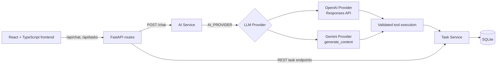

# AI Task Assistant

AI Task Assistant is a full-stack portfolio project for managing todo tasks with natural language. A React interface talks to a FastAPI backend, which can use either OpenAI or Google Gemini for tool calling. The language model proposes an operation; the backend validates its arguments and delegates all task data work to the existing Task Service and SQLite database.

This is intentionally a small, understandable project for demonstrating practical AI application engineering—not a production-ready multi-user task platform.

## Project Overview

The application supports both conventional REST task management and natural-language task management. Users can create, list, update, complete, and request deletion of tasks through chat. The backend keeps the LLM isolated from the database and applies Pydantic validation before every tool operation.

Dates and times use **Asia/Taipei** application semantics. API responses expose timezone-aware timestamps for task due dates, while SQLite stores the corresponding Taipei local time internally.

## Key Features

- FastAPI REST API for task creation, retrieval, update, completion, and deletion.
- Natural-language task operations through OpenAI Responses API or Google Gemini `generate_content`.
- Provider abstraction selected with `AI_PROVIDER`; there is no implicit provider fallback.
- Pydantic validation of all LLM tool arguments before Task Service execution.
- OpenAI multi-turn continuity with `previous_response_id`.
- Gemini multi-turn continuity with in-memory structured conversation history.
- Conversation isolation by `conversation_id`, with provider mismatch protection.
- Asia/Taipei-aware due-date validation, normalization, filtering, and response serialization.
- Backend-enforced two-step confirmation for chat-based task deletion.
- React + TypeScript + Vite client with a chat panel and task list.
- Pytest suite and GitHub Actions CI for regression checks.

## Tech Stack

| Area | Technologies |
| --- | --- |
| Backend | Python 3.12, FastAPI, Uvicorn |
| Data | SQLite, SQLAlchemy 2.x |
| Validation and settings | Pydantic, Pydantic Settings |
| LLM providers | OpenAI SDK / Responses API, Google `google-genai` SDK |
| Frontend | React, TypeScript, Vite |
| Testing | pytest, httpx / FastAPI TestClient |
| CI | GitHub Actions on Python 3.12 |

## System Architecture



The Vite development server proxies `/api/chat` to `/chat` and `/api/tasks` to `/tasks` on the FastAPI server. Providers receive a system prompt, the user message, tool definitions, and provider-specific conversation context. They never receive direct database access.

## How AI Tool Calling Works

1. The client sends a user message to `POST /chat`.
2. The chat route loads the optional in-memory conversation state and calls `AIService.run_chat()`.
3. The selected provider receives the message, current Asia/Taipei time, and the available tools: `create_task`, `list_tasks`, `update_task`, `complete_task`, and `delete_task`.
4. A provider function call is passed to the backend callback as untrusted input.
5. `execute_tool()` parses and validates the arguments with the corresponding Pydantic tool schema.
6. The callback delegates the operation to `task_service`; the provider does not construct SQL or access SQLite directly.
7. The tool result is returned to the provider, which produces the final natural-language response.

Both providers support multiple function calls in one turn. Gemini disables SDK automatic function execution so every call remains under backend validation and control.

## Conversation Management

`conversation_id` is optional. Without it, `POST /chat` is stateless. With a valid ID, the backend keeps state only in process memory:

- IDs must be 1–64 characters and use letters, numbers, hyphens, or underscores.
- At most **100 conversations** and **10 successful turns per conversation** are retained.
- OpenAI stores the final response ID and supplies it as `previous_response_id` on the next turn.
- Gemini stores structured user, model, function-call, and function-response history in `ConversationState.provider_state`.
- Gemini retains the newest complete history turns only. `GEMINI_HISTORY_TURNS` is configurable from **1 to 10** and defaults to **5**. A function call is never kept without its matching function response.
- A `conversation_id` cannot resume under a different provider; the API returns HTTP 409 instead of mixing contexts.

The frontend creates a valid ID per browser page load and reuses it for that page session. Refreshing the page creates a new frontend conversation ID.

## Safe Task Deletion

The REST endpoint `DELETE /tasks/{task_id}` performs ordinary direct CRUD deletion. Chat-based deletion is deliberately stricter:

1. The model must request `delete_task` with an explicit, validated task ID.
2. The backend checks that the task exists and records its ID and title as a pending deletion for that `conversation_id`.
3. No database row is deleted in this first tool call; the user receives a confirmation prompt.
4. Only an explicit confirmation in the same conversation triggers deletion. The backend rechecks the task ID and title before deleting.
5. Cancellation, expiry, a changed task, a missing task, a new delete intent, or application restart prevents deletion. A pending request expires after **5 minutes** and is consumed before a confirmed deletion, so it cannot be reused.

This confirmation is enforced by the backend, not merely by an LLM instruction.

## Project Structure

```text
ai-task-assistant/
├── .github/workflows/ci.yml       # Python test workflow
├── frontend/                      # React + TypeScript + Vite client
│   └── src/api/                   # Typed API client and API models
├── src/ai_task_assistant/
│   ├── api/routes/                # Chat and task HTTP routes
│   ├── core/                      # Settings and datetime helpers
│   ├── db/                        # SQLAlchemy engine and base
│   ├── models/                    # SQLAlchemy Task model
│   ├── schemas/                   # API and tool Pydantic schemas
│   ├── services/
│   │   ├── ai_service.py          # Shared prompt and validated tool execution
│   │   ├── openai_provider.py     # OpenAI Responses API implementation
│   │   ├── gemini_provider.py     # Gemini generate_content implementation
│   │   ├── conversation_service.py# In-memory state and deletion requests
│   │   └── task_service.py        # Task business/data operations
│   └── main.py                    # FastAPI application and /health
├── tests/                         # Backend unit and API tests
├── .env.example                   # Safe configuration template
├── pyproject.toml                 # Python package and test configuration
└── Dockerfile                     # Optional container image definition
```

## Getting Started

### Prerequisites

- Python **3.12**
- Node.js and npm for the frontend
- An OpenAI or Gemini API key only when using `POST /chat`

Create an isolated Python environment and install the application plus test dependencies from the repository root:

```bash
python3.12 -m venv .venv
.venv/bin/python -m pip install -e ".[dev]"
```

Create local settings from the committed template. Never commit the resulting `.env` file.

```bash
cp .env.example .env
```

The application creates the SQLite database and tables during FastAPI startup.

## Environment Variables

Settings are loaded from environment variables and, for local development, from `.env`. Select one provider and provide only that provider's API key.

| Variable | Default / valid values | Purpose |
| --- | --- | --- |
| `DATABASE_URL` | `sqlite:///./ai_task_assistant.db` | SQLAlchemy SQLite connection URL. |
| `AI_PROVIDER` | `openai`; `openai` or `gemini` | Selects the LLM provider. No fallback occurs. |
| `OPENAI_API_KEY` | unset | Required only when `AI_PROVIDER=openai`. Keep it on the backend. |
| `OPENAI_MODEL` | `gpt-4.1-mini` | Model passed to the OpenAI Responses API. |
| `GEMINI_API_KEY` | unset | Required only when `AI_PROVIDER=gemini`. Keep it on the backend. |
| `GEMINI_MODEL` | `gemini-2.5-flash`; non-empty string | Model passed to Gemini `generate_content`. |
| `GEMINI_HISTORY_TURNS` | `5`; integer from `1` to `10` | Number of complete recent Gemini turns retained in memory. |

For example, a local Gemini configuration can use a model that has been manually validated during development:

```dotenv
AI_PROVIDER=gemini
GEMINI_API_KEY=replace-with-your-key
GEMINI_MODEL=gemini-3.5-flash-lite
GEMINI_HISTORY_TURNS=5
```

Model availability, quotas, and pricing are controlled by each provider and may change. Do not assume a model or free quota will remain available.

## Running Backend and Frontend

Start the backend from the repository root:

```bash
PYTHONPATH=src .venv/bin/uvicorn ai_task_assistant.main:app --reload --host 127.0.0.1 --port 8001
```

Useful local URLs:

- Health check: <http://127.0.0.1:8001/health>
- OpenAPI documentation: <http://127.0.0.1:8001/docs>

In a separate terminal, install frontend dependencies and start Vite:

```bash
cd frontend
npm install
npm run dev
```

Open the Vite URL printed by the command (normally `http://127.0.0.1:5173`). The frontend uses its development proxy, so it expects FastAPI at `http://127.0.0.1:8001`.

## Running Tests

Run the complete backend test suite from the repository root:

```bash
PYTHONPATH=src .venv/bin/python -m pytest
```

The tests mock OpenAI and Gemini clients; they do not require an API key and do not make live provider requests. Build the frontend TypeScript application with:

```bash
cd frontend
npm run build
```

GitHub Actions runs `python -m pip install -e ".[dev]"` and `python -m pytest` on Ubuntu with Python 3.12 for every push and pull request. Workflow status is available in the repository's **Actions** tab and on pull requests.

## API Endpoints

| Method | Endpoint | Description |
| --- | --- | --- |
| `GET` | `/health` | Returns `{"status":"ok"}`. |
| `POST` | `/tasks` | Creates a task. |
| `GET` | `/tasks` | Lists tasks. |
| `GET` | `/tasks/{task_id}` | Retrieves one task. |
| `PATCH` | `/tasks/{task_id}` | Updates provided task fields. |
| `DELETE` | `/tasks/{task_id}` | Deletes one task directly through the REST API. |
| `POST` | `/chat` | Processes a natural-language message through the selected provider. |

`POST /chat` request:

```json
{
  "conversation_id": "demo-001",
  "message": "把剛剛的任務改成晚上八點"
}
```

`conversation_id` is optional. A successful response always contains `response`; it includes `conversation_id` when one was supplied:

```json
{
  "conversation_id": "demo-001",
  "response": "好的，已修改任務。"
}
```

`GET /tasks` returns an array of objects containing `id`, `title`, `description`, `due_date`, `priority`, `status`, `created_at`, and `updated_at`. `due_date` is either `null` or an ISO 8601 value with the `+08:00` Asia/Taipei offset.

## Optional Docker Usage

The repository includes a Python 3.12 Dockerfile that runs the API as a non-root user on port 8000. Build it with:

```bash
docker build -t ai-task-assistant .
```

Pass provider settings only at runtime, never in the image:

```bash
docker run --rm --name ai-task-assistant -p 8000:8000 \
  -e AI_PROVIDER=gemini \
  -e GEMINI_API_KEY=replace-with-your-key \
  -e GEMINI_MODEL=gemini-3.5-flash-lite \
  ai-task-assistant
```

For durable SQLite storage outside the container layer, mount the image's writable `/data` directory and use an absolute SQLite URL:

```bash
docker volume create ai-task-assistant-data

docker run --rm --name ai-task-assistant -p 8000:8000 \
  -v ai-task-assistant-data:/data \
  -e DATABASE_URL="sqlite:////data/ai_task_assistant.db" \
  ai-task-assistant
```

Verify `http://127.0.0.1:8000/health` after startup. Docker image build and runtime verification are not part of the documentation checks in this repository environment.

## Limitations and Future Improvements

- Authentication and authorization are not implemented.
- Conversation history and pending deletion requests are in memory only; both disappear after an application restart and are not shared between processes.
- The application is designed for a local demo, not for direct public deployment or a multi-user environment.
- `conversation_id` is an identifier, not an access-control mechanism.
- Gemini history is limited by complete turns, not an exact token budget.
- SQLite is appropriate for this portfolio scope but is not a substitute for production data, migration, backup, concurrency, or tenant-isolation design.
- API keys must remain server-side. Provider usage may incur cost depending on the selected model and account plan.
- Potential next steps include persistent authenticated users, durable conversation storage, stricter rate limiting, observability, frontend tests, and production deployment design.
