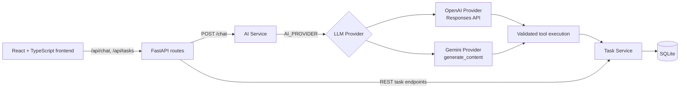

# AI Task Assistant

AI Task Assistant is a full-stack portfolio project for managing todo tasks with natural language. A React interface talks to a FastAPI backend, which can use either OpenAI or Google Gemini for tool calling. The language model proposes an operation; the backend validates its arguments and delegates all task data work to the existing Task Service and SQLite database.

This is intentionally a small, understandable project for demonstrating practical AI application engineering—not a production-ready multi-user task platform.

## Project Overview

The application supports both conventional REST task management and natural-language task management. Users can create, list, update, complete, and request deletion of tasks through chat. The backend keeps the LLM isolated from the database and applies Pydantic validation before every tool operation.

Dates and times use **Asia/Taipei** application semantics. API responses expose timezone-aware timestamps for task due dates, while SQLite stores the corresponding Taipei local time internally.

## Key Features

- FastAPI REST API for task creation, retrieval, update, completion, and deletion.
- Natural-language task operations through OpenAI Responses API or Google Gemini `generate_content`.
- Provider abstraction selected with `AI_PROVIDER`; there is no implicit provider fallback.
- Pydantic validation of all LLM tool arguments before Task Service execution.
- OpenAI multi-turn continuity with `previous_response_id`.
- SQLite-persisted multi-turn state for OpenAI response IDs and Gemini structured history.
- Conversation isolation by authenticated user and `conversation_id`, with provider mismatch protection.
- Asia/Taipei-aware due-date validation, normalization, filtering, and response serialization.
- Backend-enforced two-step confirmation for chat-based task deletion.
- React + TypeScript + Vite client with a chat panel and task list.
- Pytest suite and GitHub Actions CI for regression checks.

## Tech Stack

| Area | Technologies |
| --- | --- |
| Backend | Python 3.12, FastAPI, Uvicorn |
| Data | SQLite, SQLAlchemy 2.x |
| Validation and settings | Pydantic, Pydantic Settings |
| LLM providers | OpenAI SDK / Responses API, Google `google-genai` SDK |
| Frontend | React, TypeScript, Vite |
| Testing | pytest, httpx / FastAPI TestClient |
| CI | GitHub Actions on Python 3.12 |

## System Architecture



The Vite development server proxies `/api/*` to FastAPI on port `8001`. Its React client uses the HttpOnly session cookie with `credentials: "include"`, requests a separate CSRF token from `/auth/csrf`, and never stores either session credentials or passwords in browser storage. Providers receive a system prompt, the user message, tool definitions, and provider-specific conversation context. They never receive direct database access.

## How AI Tool Calling Works

1. The client sends a user message to `POST /chat`.
2. The chat route loads the optional persisted conversation state and calls `AIService.run_chat()`.
3. The selected provider receives the message, current Asia/Taipei time, and the available tools: `create_task`, `list_tasks`, `update_task`, `complete_task`, and `delete_task`.
4. A provider function call is passed to the backend callback as untrusted input.
5. `execute_tool()` parses and validates the arguments with the corresponding Pydantic tool schema.
6. The callback delegates the operation to `task_service`; the provider does not construct SQL or access SQLite directly.
7. The tool result is returned to the provider, which produces the final natural-language response.

Both providers support multiple function calls in one turn. Gemini disables SDK automatic function execution so every call remains under backend validation and control.

## Conversation Management

`conversation_id` is optional. Without it, `POST /chat` is stateless. With a valid ID, the backend persists provider-specific conversation state in SQLite under the authenticated user:

- IDs must be 1–64 characters and use letters, numbers, hyphens, or underscores.
- At most **100 conversations** and **10 successful turns per conversation** are retained.
- OpenAI stores the final response ID and supplies it as `previous_response_id` on the next turn. Remote OpenAI response state can still expire independently.
- Gemini stores versioned JSON for structured user, model, function-call, and function-response history. The codec rejects invalid or incomplete tool-call pairs rather than silently discarding them.
- Gemini retains the newest complete history turns only. `GEMINI_HISTORY_TURNS` is configurable from **1 to 10** and defaults to **5**. A function call is never kept without its matching function response.
- A `conversation_id` cannot resume under a different provider for the same user; the API returns HTTP 409 instead of mixing contexts. Different users may use the same ID without sharing state.
- `CONVERSATION_RETENTION_DAYS` defaults to **30** and must be positive. When a new or already-expired conversation ID is used, the backend synchronously removes conversations with `updated_at` strictly older than the Taipei-time cutoff before checking the 100-conversation limit. Tasks are never removed by this cleanup.
- A cleaned `conversation_id` starts a new conversation. A stale in-flight request can only update with its expected `state_version`; if cleanup removed it first, the request returns HTTP 409 and cannot revive the old state.

The authenticated frontend creates a valid ID for each workspace session and reuses it for that session. Logout, a session-expiry response, or a page refresh clears client chat state and creates a new ID; it is not an authentication credential.

## Safe Task Deletion

The REST endpoint `DELETE /tasks/{task_id}` performs ordinary direct CRUD deletion. Chat-based deletion is deliberately stricter:

1. The model must request `delete_task` with an explicit, validated task ID.
2. The backend checks that the task exists and records its ID and title as a pending deletion for that `conversation_id`.
3. No database row is deleted in this first tool call; the user receives a confirmation prompt.
4. Only an explicit confirmation in the same conversation triggers deletion. The backend rechecks the task ID and title before deleting.
5. Cancellation, expiry, a changed task, a missing task, a new delete intent, or application restart prevents deletion. A pending request expires after **5 minutes** and is consumed before a confirmed deletion, so it cannot be reused.

This confirmation is enforced by the backend, not merely by an LLM instruction.

## Project Structure

```text
ai-task-assistant/
├── .github/workflows/ci.yml       # Python test workflow
├── frontend/                      # React + TypeScript + Vite client
│   └── src/api/                   # Typed API client and API models
├── src/ai_task_assistant/
│   ├── api/routes/                # Chat and task HTTP routes
│   ├── core/                      # Settings and datetime helpers
│   ├── db/                        # SQLAlchemy engine and base
│   ├── models/                    # SQLAlchemy Task model
│   ├── schemas/                   # API and tool Pydantic schemas
│   ├── services/
│   │   ├── ai_service.py          # Shared prompt and validated tool execution
│   │   ├── openai_provider.py     # OpenAI Responses API implementation
│   │   ├── gemini_provider.py     # Gemini generate_content implementation
│   │   ├── conversation_service.py# SQLite conversation state, retention, deletion requests
│   │   └── task_service.py        # Task business/data operations
│   └── main.py                    # FastAPI application and /health
├── tests/                         # Backend unit and API tests
├── .env.example                   # Safe configuration template
├── pyproject.toml                 # Python package and test configuration
└── Dockerfile                     # Optional container image definition
```

## Getting Started

### Prerequisites

- Python **3.12**
- Node.js and npm for the frontend
- An OpenAI or Gemini API key only when using `POST /chat`

Create an isolated Python environment and install the application plus test dependencies from the repository root:

```bash
python3.12 -m venv .venv
.venv/bin/python -m pip install -e ".[dev]"
```

Create local settings from the committed template. Never commit the resulting `.env` file.

```bash
cp .env.example .env
```

The application creates the SQLite database and tables during FastAPI startup.

## Environment Variables

Settings are loaded from environment variables and, for local development, from `.env`. Select one provider and provide only that provider's API key.

| Variable | Default / valid values | Purpose |
| --- | --- | --- |
| `DATABASE_URL` | `sqlite:///./ai_task_assistant.db` | SQLAlchemy SQLite connection URL. |
| `AI_PROVIDER` | `openai`; `openai` or `gemini` | Selects the LLM provider. No fallback occurs. |
| `OPENAI_API_KEY` | unset | Required only when `AI_PROVIDER=openai`. Keep it on the backend. |
| `OPENAI_MODEL` | `gpt-4.1-mini` | Model passed to the OpenAI Responses API. |
| `GEMINI_API_KEY` | unset | Required only when `AI_PROVIDER=gemini`. Keep it on the backend. |
| `GEMINI_MODEL` | `gemini-2.5-flash`; non-empty string | Model passed to Gemini `generate_content`. |
| `GEMINI_HISTORY_TURNS` | `5`; integer from `1` to `10` | Number of complete recent Gemini turns retained in persisted history. |
| `CONVERSATION_RETENTION_DAYS` | `30`; positive integer | Days to retain persisted conversations before synchronous cleanup. |
| `SESSION_TTL_HOURS` | `24`; integer from `1` to `720` | Lifetime of a server-side browser session. |
| `SESSION_COOKIE_SECURE` | `true` | Sends the session cookie only over HTTPS. Set to `false` only for local HTTP development. |
| `SESSION_COOKIE_SAMESITE` | `lax`; `lax` or `strict` | SameSite policy for the session and CSRF cookies. |
| `AUTH_ALLOWED_ORIGINS` | `http://127.0.0.1:5173,http://localhost:5173` | Comma-separated origins permitted for authentication CSRF protection. Use explicit HTTPS origins outside local development. |
| `CHAT_USER_LIMIT` / `CHAT_USER_WINDOW_SECONDS` | `10` / `60` | In-memory per-user chat minute limit. Single-process only. |
| `CHAT_DAILY_QUOTA` | `50`; positive integer | Durable SQLite per-user, Asia/Taipei-day request reservation. It is not a token or monetary budget. |
| `CHAT_CONCURRENT_LIMIT` | `1`; integer from `1` to `10` | In-memory per-user concurrent provider request limit. Single-process only. |
| `CHAT_INPUT_MAX_LENGTH` | `4000`; integer from `1` to `20000` | Maximum accepted chat input length. |
| `PROVIDER_MAX_CALLS_PER_CHAT` | `5`; integer from `2` to `10` | Maximum provider calls for one chat request. |
| `PROVIDER_MAX_TOOL_ROUNDS` | `5`; integer from `1` to `10` | Maximum tool-calling rounds in one chat request. |
| `PROVIDER_REQUEST_TIMEOUT_SECONDS` | `30`; integer from `1` to `120` | Provider request timeout. |
| `PROVIDER_MAX_OUTPUT_TOKENS` | `512`; integer from `16` to `4096` | Requested maximum provider output tokens where the provider supports it. |

For example, a local Gemini configuration can use a model that has been manually validated during development:

```dotenv
AI_PROVIDER=gemini
GEMINI_API_KEY=replace-with-your-key
GEMINI_MODEL=gemini-3.5-flash-lite
GEMINI_HISTORY_TURNS=5
```

Model availability, quotas, and pricing are controlled by each provider and may change. Do not assume a model or free quota will remain available.

## Running Backend and Frontend

Start the backend from the repository root:

```bash
PYTHONPATH=src .venv/bin/uvicorn ai_task_assistant.main:app --reload --host 127.0.0.1 --port 8001
```

Useful local URLs:

- Health check: <http://127.0.0.1:8001/health>
- OpenAPI documentation: <http://127.0.0.1:8001/docs>

In a separate terminal, install frontend dependencies and start Vite:

```bash
cd frontend
npm install
npm run dev
```

Open the Vite URL printed by the command (normally `http://127.0.0.1:5173`). The frontend uses its development proxy, so it expects FastAPI at `http://127.0.0.1:8001`.

## Authentication API

The API provides a small server-side session foundation:

- `POST /auth/register` creates an account. Passwords are stored only as Argon2id hashes.
- `POST /auth/login` verifies credentials and issues an opaque, HttpOnly session cookie. SQLite stores only the token's SHA-256 digest.
- `GET /auth/me` returns the authenticated user's `id` and `email`.
- `POST /auth/logout` revokes the current session and clears its cookies.

Authentication mutations (`/auth/register`, `/auth/login`, and `/auth/logout`) require an exact `Origin` allowed by `AUTH_ALLOWED_ORIGINS` and a double-submit CSRF token. First request `GET /auth/csrf` with that `Origin`; send the returned `csrf_token` in `X-CSRF-Token` while the browser retains the `ai_task_csrf` cookie. The CSRF token is separate from the HttpOnly session cookie.

When a mutation is rejected before endpoint execution because its CSRF token is invalid, the API returns HTTP `403` with `detail.code` set to `csrf_validation_failed`. The frontend obtains one fresh token and retries only that explicit condition once. It does not retry other `403`, `401`, or `429` responses.

For local HTTP development, set `SESSION_COOKIE_SECURE=false` in an uncommitted `.env`. Keep the default `true` with HTTPS in production. The React client obtains a CSRF token in memory and uses `/auth/me` as its authentication-state source.

`/tasks` and `/chat` require an authenticated session. `POST`, `PATCH`, and `DELETE` Task operations, plus `POST /chat`, also require the same Origin and CSRF protection as authentication mutations. The React client shows a protected workspace only after `/auth/me` succeeds, and returns to the login screen on an authenticated API `401` response.

## Request Limits and AI Guardrails

The application applies these default limits before expensive work begins:

- Login: 10 requests per IP per minute and 5 requests per normalized email per 5 minutes.
- Registration: 5 requests per IP per hour.
- CSRF token issuance: 30 requests per IP per minute.
- Chat: 10 requests per authenticated user per minute, 50 admitted requests per Asia/Taipei calendar day, and 1 in-flight provider request per user.

Rate-limited requests return `429` with a `Retry-After` header. Failed provider calls still consume an admitted daily chat request; the server does not automatically retry provider calls. Chat input length, provider calls per chat, tool rounds, request timeout, and maximum output tokens are configurable through the environment variables in `.env.example`.

The daily chat quota is a **durable SQLite reservation** keyed by authenticated user and Asia/Taipei date. It is atomically reserved before the provider call, persists across process restarts, and is still consumed if the provider fails. No SQLite write transaction remains open while an LLM request is running. The minute limiter and in-flight guard are intentionally **in-memory and single-process only**: they reset on restart and do not coordinate multiple Uvicorn workers, containers, or replicas.

The supported topology for this MVP is **one application process with one SQLite database**. Do not run multiple Uvicorn workers or replicas and claim shared concurrency protection. A future multi-worker deployment needs shared rate limiting and a distributed in-flight lease (for example, a deliberately designed Redis-based service). The SQLite quota counts admitted requests—not input/output tokens or money—so provider-side budget caps and account alerts remain necessary.

The application uses `Request.client.host` and intentionally ignores arbitrary `X-Forwarded-For`. Behind a reverse proxy, configure Uvicorn proxy-header trust only for a known proxy address or network; never use `--forwarded-allow-ips="*"`. Production requires HTTPS, `SESSION_COOKIE_SECURE=true`, and explicit HTTPS values in `AUTH_ALLOWED_ORIGINS`; do not use wildcard credentialed CORS. See [deployment security notes](docs/deployment-security.md) before deployment.

## Running Tests

Run the complete backend test suite from the repository root:

```bash
PYTHONPATH=src .venv/bin/python -m pytest
```

The tests mock OpenAI and Gemini clients; they do not require an API key and do not make live provider requests. Build the frontend TypeScript application with:

```bash
cd frontend
npm run build
```

Run the frontend unit tests with:

```bash
cd frontend
npm run test -- --run
```

### Browser E2E tests

Playwright browser tests run against owned, localhost-only FastAPI and Vite child processes. The E2E launcher refuses occupied ports instead of using an arbitrary existing service, tracks only the processes it creates, and terminates them when the run ends or startup fails. Tests use a temporary SQLite file, set `AI_TASK_ASSISTANT_DISABLE_DOTENV=1`, provide placeholder provider keys, and replace the LLM provider with a test-only mock. They never use the development database or make OpenAI/Gemini requests.

Install the browser once, then run the E2E suite:

```bash
cd frontend
npx playwright install chromium
npm run test:e2e
```

The E2E suite covers browser login/register, HttpOnly cookie flow, `/auth/me`, CSRF rejection, authenticated Task CRUD API calls, mock chat, quota feedback, logout, and user task isolation. GitHub Actions installs Chromium with Linux dependencies and runs this suite in a separate Browser E2E job. It does not validate production HTTPS, reverse-proxy forwarding, real provider behavior, or a deployed browser environment.

GitHub Actions runs `python -m pip install -e ".[dev]"` and `python -m pytest` on Ubuntu with Python 3.12 for every push and pull request. Workflow status is available in the repository's **Actions** tab and on pull requests.

## API Endpoints

| Method | Endpoint | Description |
| --- | --- | --- |
| `GET` | `/health` | Returns `{"status":"ok"}`. |
| `GET` | `/auth/csrf` | Issues a CSRF token for an allowed browser origin. |
| `POST` | `/auth/register` | Creates a user account; requires Origin and CSRF validation. |
| `POST` | `/auth/login` | Creates an HttpOnly server-side session; requires Origin and CSRF validation. |
| `GET` | `/auth/me` | Returns the current authenticated user. |
| `POST` | `/auth/logout` | Revokes the current session; requires Origin and CSRF validation. |
| `POST` | `/tasks` | Creates a task for the authenticated user; requires Origin and CSRF validation. |
| `GET` | `/tasks` | Lists only the authenticated user's tasks. |
| `GET` | `/tasks/{task_id}` | Retrieves one owned task. |
| `PATCH` | `/tasks/{task_id}` | Updates one owned task; requires Origin and CSRF validation. |
| `DELETE` | `/tasks/{task_id}` | Deletes one owned task; requires Origin and CSRF validation. |
| `POST` | `/chat` | Processes a natural-language message in the authenticated user's scope; requires Origin and CSRF validation. |

`POST /chat` request:

```json
{
  "conversation_id": "demo-001",
  "message": "把剛剛的任務改成晚上八點"
}
```

`conversation_id` is optional. A successful response always contains `response`; it includes `conversation_id` when one was supplied:

```json
{
  "conversation_id": "demo-001",
  "response": "好的，已修改任務。"
}
```

`GET /tasks` returns an array of objects containing `id`, `title`, `description`, `due_date`, `priority`, `status`, `created_at`, and `updated_at`. `due_date` is either `null` or an ISO 8601 value with the `+08:00` Asia/Taipei offset.

## Optional Docker Usage

The repository includes a Python 3.12 Dockerfile that runs the API as a non-root user on port 8000. Build it with:

```bash
docker build -t ai-task-assistant .
```

Pass provider settings only at runtime, never in the image:

```bash
docker run --rm --name ai-task-assistant -p 8000:8000 \
  -e AI_PROVIDER=gemini \
  -e GEMINI_API_KEY=replace-with-your-key \
  -e GEMINI_MODEL=gemini-3.5-flash-lite \
  ai-task-assistant
```

For durable SQLite storage outside the container layer, mount the image's writable `/data` directory and use an absolute SQLite URL:

```bash
docker volume create ai-task-assistant-data

docker run --rm --name ai-task-assistant -p 8000:8000 \
  -v ai-task-assistant-data:/data \
  -e DATABASE_URL="sqlite:////data/ai_task_assistant.db" \
  ai-task-assistant
```

Verify `http://127.0.0.1:8000/health` after startup. Docker image build and runtime verification are not part of the documentation checks in this repository environment.

## Limitations and Future Improvements

- Task and Conversation ownership are enforced in application code. However, a legacy SQLite database must be migrated before startup; the application now fails closed when it detects the old globally scoped Task or Conversation schema.
- Conversation state persists in SQLite, but pending deletion authorization remains process-local and disappears after an application restart. It is deliberately not restored from Gemini/OpenAI history.
- The application is designed for a local demo, not for direct public deployment or a multi-user environment.
- `conversation_id` is scoped by the authenticated user and is not independently sufficient for access.
- Gemini history is limited by complete turns, not an exact token budget.
- `Base.metadata.create_all()` creates missing tables only; it is not a schema migration system. Existing databases need a deliberate migration before any future model-column change.
- Task CRUD executed during tool calling and the final conversation-state write are separate transactions. A later provider or optimistic-lock conflict cannot roll back an already completed task operation.
- SQLite is appropriate for this portfolio scope but is not a substitute for production data, migration, backup, concurrency, or tenant-isolation design.
- API keys must remain server-side. Provider usage may incur cost depending on the selected model and account plan.
- Durable daily quota tracks request admission only; it is not exact token accounting or a provider billing cap. Configure provider-side budgets and alerts before using paid APIs.
- The minute and concurrent chat guards are single-process only. A multi-worker or multi-replica deployment needs shared rate limiting and distributed leases.
- Potential next steps include provider usage observability, end-to-end browser tests, and production deployment design.
