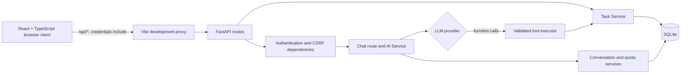
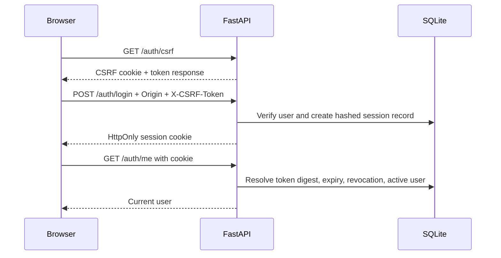
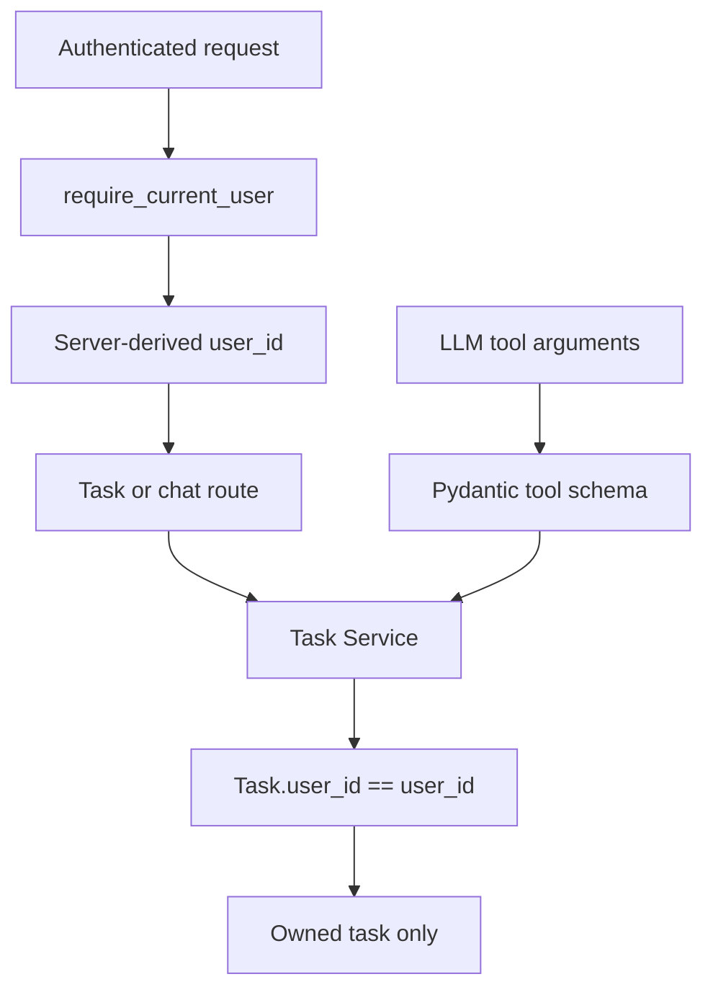
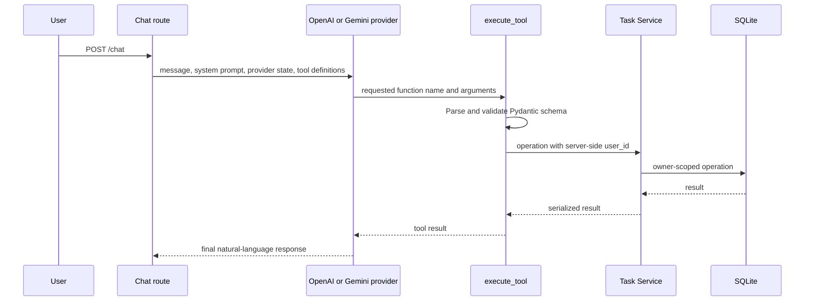
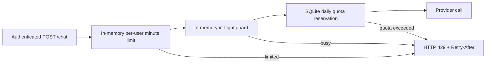

# Architecture Notes

## Scope and topology

AI Task Assistant is a single-process FastAPI and SQLite MVP with a React + TypeScript client. It supports authenticated, user-scoped task management through REST endpoints and LLM-assisted chat. The supported topology is **one application process connected to one SQLite database**. The project does not claim multi-worker or multi-replica coordination.

In local development, Vite proxies `/api/*` to FastAPI. The browser keeps the session cookie under browser control and includes it through `credentials: "include"`; frontend code does not read the session cookie or store it in browser storage.

## Authentication and request protection

- Passwords use Argon2id. The database contains a password hash, never the raw password.
- Login creates a new opaque session token. SQLite stores a SHA-256 digest of that high-entropy token.
- Mutating requests require a precise allowed `Origin` and matching double-submit CSRF cookie/header values.
- `GET /auth/csrf` may omit `Origin` because browsers do not guarantee it for a same-origin safe GET. An explicitly disallowed Origin is rejected, and every mutation remains strict.
- The frontend retries exactly once only for the explicit backend error code `csrf_validation_failed`; it does not retry ordinary 403, 401, or 429 responses.

`SESSION_COOKIE_SECURE` defaults to `true`. Local HTTP development requires an explicit uncommitted override; production requires HTTPS and explicit HTTPS values in `AUTH_ALLOWED_ORIGINS`.

## Ownership and Task Service boundary

All Task Service entry points require `user_id`. Routes derive it from the server-side session; request bodies and LLM tool arguments do not expose an owner field. Reads and mutations use owner-scoped lookups, so an unknown or another user's task ID produces the same not-found response.

The LLM provider does not receive a database connection. A tool call is treated as untrusted input, validated by a Pydantic schema, then delegated to the Task Service with the authenticated user's ID. This means prompt injection cannot grant a tool call access to a different user's records.

## Provider abstraction and tool calling

The provider interface intentionally avoids exposing OpenAI response objects or Gemini SDK objects to shared service code.

- **OpenAI:** uses the Responses API and persists the final response ID for `previous_response_id` continuity.
- **Gemini:** uses `google-genai` `generate_content`, disables automatic function execution, and retains structured history locally.
- Both providers expose the same task tools: create, list, update, complete, and request deletion.
- Chat-based deletion is a backend-enforced two-step operation. A tool call creates an in-memory pending confirmation; only a later explicit confirmation in the same user and conversation scope can delete the task.

## Conversation persistence

Conversation records are stored in SQLite and keyed by `(user_id, conversation_id)`.

- OpenAI state stores the final response ID.
- Gemini state stores versioned JSON representing user, model, function-call, and function-response history.
- Provider mismatch, malformed Gemini history, stale optimistic updates, and invalid prior state fail safely rather than silently starting a different context.
- A conversation permits up to 10 successful turns. Each user can retain up to 100 conversations.
- Retention cleanup uses `updated_at` and Asia/Taipei time. It runs when preparing a new or expired conversation, not during every ordinary query.
- Optimistic locking uses a state version and row identity. A stale request cannot overwrite another response or revive a row that cleanup removed.

Pending deletion state deliberately remains process-local, expires after five minutes, and disappears on restart. It is not restored from conversation history.

## Quotas and rate limits

The daily quota is an atomic SQLite reservation per authenticated user and Asia/Taipei calendar day. It is committed before a provider call, survives process restart, and still counts a request when the provider fails. A quota storage failure fails closed before provider access.

The minute limiter and concurrent request guard use process-local memory protected by a thread lock. They are intentionally limited to a single process: they reset on restart and are not shared by workers, containers, or replicas. They are not a distributed rate-limit or billing system.

## Persistence, schema, and deployment boundary

SQLite foreign keys are enabled for application connections. Startup checks that existing Task and Conversation tables contain the owner-scoped columns, indexes, foreign keys, and composite conversation uniqueness expected by the application. An incompatible legacy schema fails closed; startup does not automatically run a migration.

The repository includes an ownership migration tool and test coverage, but a real database migration is an operational procedure: stop writes, create and protect a backup outside the repository, apply and verify the migration, then validate rollback plans. `Base.metadata.create_all()` creates absent tables only and is not a migration framework.

See [Deployment Security Notes](deployment-security.md) for HTTPS, reverse-proxy, SQLite backup, provider-budget, and single-process requirements.
